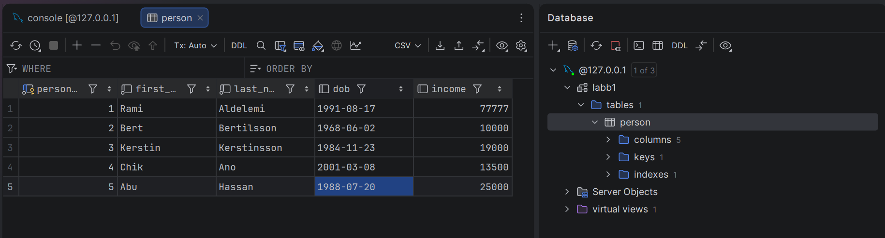
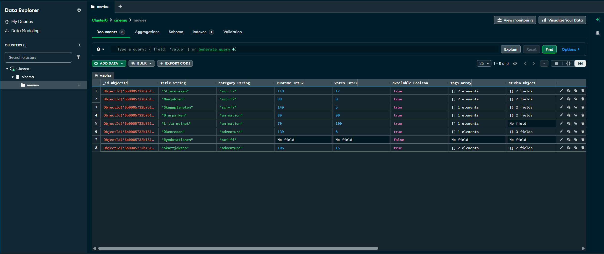
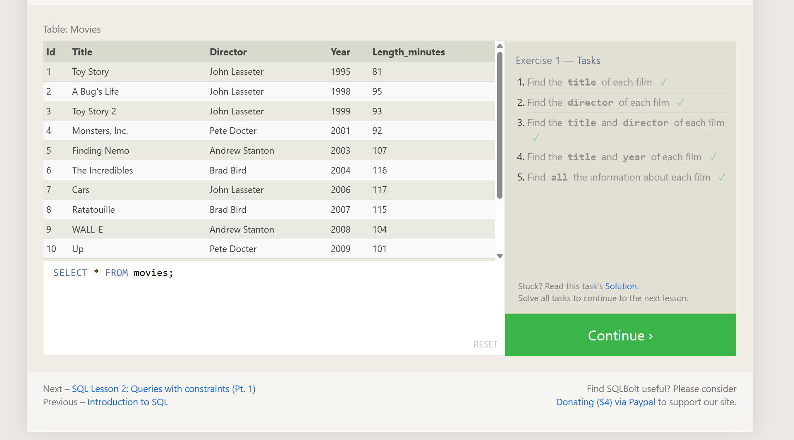
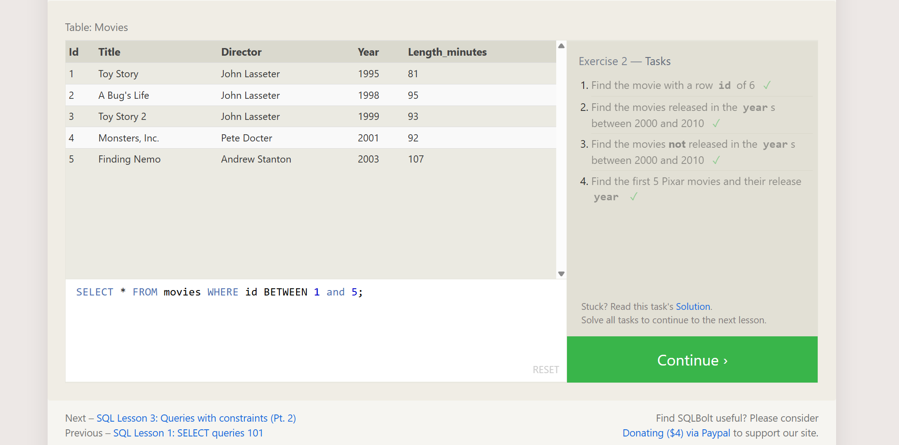

# Labb1 - Rami Aldelemi

## MySQL



## MongoDB



## SQL




# G-nivå

## Databaser och verktyg

1. En databas är ett ställe där man sparar och organiserar information så att den är lätt att hitta och ändra.
   Till exempel kan en webbutik spara sina kunder och beställningar där.

2. SQL används för att hämta, lägga till, ändra och ta bort data i en relationsdatabas.
   Man kan också skapa tabeller med SQL.

## Tabeller och relationer

3. En tabell består av rader och kolumner. I en persontabell kan varje rad vara en person och varje kolumn en uppgift,
   till exempel förnamn.

4. En primärnyckel är ett unikt värde för varje rad, till exempel ett person-ID.
   Den gör att man kan hitta rätt person även om flera personer har samma namn.

5. En främmande nyckel kopplar ihop tabeller. Till exempel kan ett köp ha ett kund-ID som pekar på kunden som gjorde
   köpet.

6. En kund kan göra flera köp. Med två tabeller räcker det att spara kundens uppgifter en gång,
   så om kunden byter adress behöver man bara ändra den på ett ställe.

## NoSQL

7. NoSQL är ett samlingsnamn för flera typer av databaser. I MongoDB sparas informationen i dokument som grupperas i
   samlingar.
   Dokumenten i en samling kan ha olika fält.

8. MongoDB kan passa för en filmsamling där vissa filmer har en lista med priser de har vunnit.
   Det fältet kan läggas till i de filmer där det behövs.

## SQL – hämta data från tabellen person

```sql 
SELECT *
FROM person;
```

```sql 
SELECT first_name, last_name
FROM person;
```

```sql 
SELECT first_name, last_name, income
FROM person
WHERE income > 30000;
```

```sql 
SELECT *
FROM person
WHERE dob < '1990-01-01';
```

```sql 
SELECT first_name, last_name, income
FROM person
ORDER BY income DESC;
```

```sql 
SELECT COUNT(*)
FROM Person;
```

# VG-nivå

### Banköverföring och transaktioner

Om jag skickar 500 kr till någon och överföringen avbryts efter att pengarna dragits kan mitt saldo minska med 500 kr
utan att mottagaren får något.
Då stämmer inget av saldona med hur överföringen skulle ha gått till. Om jag ser att mottagaren inte fått pengarna
och provar igen kan det också bli svårt att veta vad som hände med den första överföringen.

Med en transaktion kan banken göra båda ändringarna som en och samma operation. Först dras 500 kr från mitt konto och
sedan läggs 500 kr till på mottagarens konto. När båda ändringarna har lyckats bekräftas transaktionen och ändringarna
sparas. Om något går fel innan dess kan databasen rulla tillbaka transaktionen. Det betyder att den första ändringen
också tas tillbaka så att båda kontona har samma saldo som före försöket.
På så sätt sparas antingen hela överföringen eller ingen del av den.

### Relationsdatabas och NoSQL i en webbutik

Jag hade valt en relationsdatabas för kunder och beställningar i en webbutik. En kund kan göra flera beställningar och
varje beställning kan ha flera produkter. Kunder och beställningar kan ligga i olika tabeller och kopplas ihop med
kund-ID. Då kan butiken lätt visa alla beställningar för en viss kund. I varje beställning kan man också spara priset
kunden betalade, så att gamla beställningar fortfarande visar rätt pris även om produkten blir dyrare senare.

En NoSQL-databas som MongoDB kan passa för själva produktkatalogen. Butiken kanske säljer både tröjor och datorer. En
tröja behöver fält för storlek och material, medan en dator behöver uppgifter om processor och minne. Då kan varje
produkt vara ett dokument med de uppgifter som behövs för att visa den på produktsidan. Om butiken börjar sälja skor kan
den lägga till fält för skostorlek i de nya dokumenten. Valet beror alltså på vad butiken behöver göra med uppgifterna.
För beställningar är kopplingarna viktiga, medan produktkatalogen behöver kunna hantera olika slags produktuppgifter.